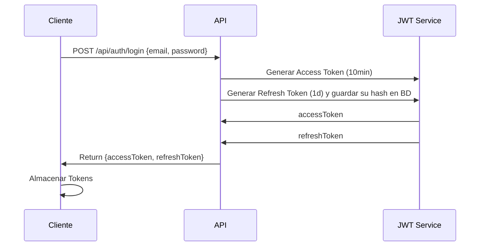
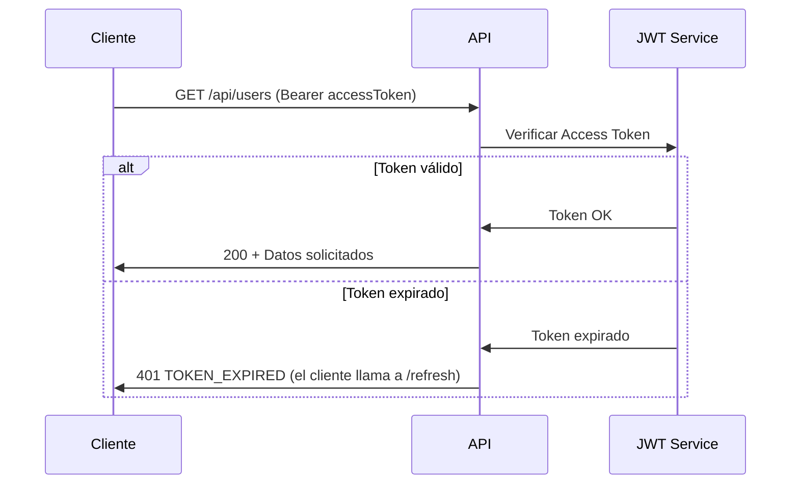
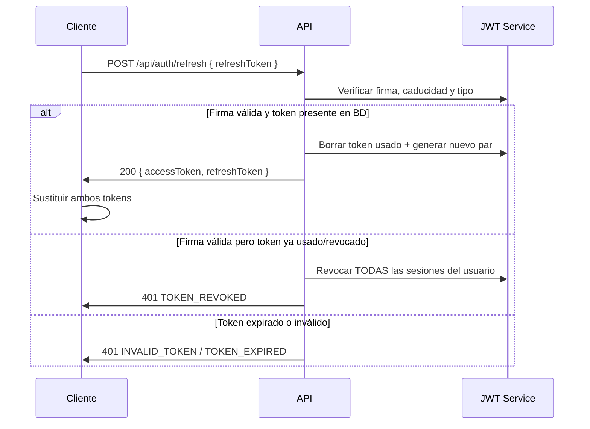

# EA API REST + JWT con Express y TypeScript

Este proyecto implementa una API REST con autenticación JWT usando Express y TypeScript. Incluye manejo de tokens de acceso y refresh tokens para una mejor seguridad.

## Estructura del Proyecto

```
├── src/
│   ├── config/                    # env (secretos, TTLs), logger, db, seed
│   ├── controllers/
│   │   ├── auth.controller.ts     # register, login, refresh, logout, cambio de password
│   │   └── user.controller.ts     # CRUD del recurso /users (sin password)
│   ├── errors/ApiError.ts         # Errores tipados -> { message, code }
│   ├── middlewares/
│   │   ├── jwtMiddleware.ts       # authenticate, verifyRefreshToken, isOwner
│   │   ├── validatorMiddleware.ts # Validación Zod de body/query
│   │   ├── errorHandler.ts        # Único punto que formatea errores
│   │   └── loggerMiddleware.ts
│   ├── models/
│   │   ├── user.model.ts          # User (+ PublicUser, esquemas PUT/PATCH)
│   │   ├── auth.model.ts          # DTOs con password (register, login, password)
│   │   ├── refreshToken.model.ts  # Refresh tokens persistidos (revocables)
│   │   ├── jwtpayload.model.ts    # Payload del JWT (Zod) + ampliación de tipos de Express
│   │   └── http.ts
│   ├── routes/
│   │   ├── auth.routes.ts         # /auth/* y /users/:id/password
│   │   └── user.routes.ts         # /users
│   ├── services/
│   │   ├── auth.service.ts        # Hash de passwords, emisión/rotación/revocación de tokens
│   │   └── user.service.ts        # Datos de usuario (nunca devuelve el hash)
│   ├── app.ts
│   └── index.ts
├── test/api.http                  # Peticiones para REST Client (VS Code)
└── .env.example
```

## Requisitos Previos

- Node.js 20 o superior y npm
- MongoDB en local (o `MONGO_URI` en `.env`)

Instalar dependencias y crear la configuración:

```
npm install
cp .env.example .env
```

## Uso

1. Compilar el proyecto:

```
npm run build
```

2. Iniciar el servidor:

```
npm start
```

El servidor se iniciará en http://localhost:4000

## Endpoints de la API

Errores siempre con la forma `{ "message": "...", "code": "..." }`.

### Autenticación (`auth.routes.ts`)

| Método | Ruta                      | Protección                 | Respuesta                                       |
| ------ | ------------------------- | -------------------------- | ----------------------------------------------- |
| POST   | `/api/auth/register`      | —                          | 201 + `Location` · 409 email repetido · 422     |
| POST   | `/api/auth/login`         | —                          | 200 `{ user, accessToken, refreshToken }` · 401 |
| POST   | `/api/auth/refresh`       | refresh token (body)       | 200 nuevo par de tokens · 401                   |
| POST   | `/api/auth/logout`        | refresh token (body)       | 204                                             |
| PUT    | `/api/users/:id/password` | access token + propietario | 204 · 403 password actual incorrecta            |

### Usuarios (`user.routes.ts`, sin password)

| Método | Ruta                            | Protección                 |
| ------ | ------------------------------- | -------------------------- |
| GET    | `/api/users?role=`              | access token               |
| GET    | `/api/users/:id`                | access token               |
| PUT    | `/api/users/:id` (name + email) | access token + propietario |
| PATCH  | `/api/users/:id` (parcial)      | access token + propietario |
| DELETE | `/api/users/:id`                | access token + propietario |

## Testing

El proyecto incluye `test/api.http` para la extensión REST Client de VS Code. Guarda automáticamente los tokens JWT para reutilizarlos.

## Implementación de JWT

1. **Access token** — 10 min, secreto propio, `Authorization: Bearer <token>`. Stateless: no se consulta la BD.
2. **Refresh token** — 1 día, secreto propio, viaja en el body `{ refreshToken }`. Se guarda su hash SHA-256 en la colección `refreshtokens` (índice TTL), por lo que se puede **revocar**:
   - `logout` borra ese token.
   - `refresh` lo **rota**: borra el usado y emite un par nuevo. Si llega un token ya usado, se revocan todas las sesiones del usuario (posible robo).
   - Cambiar la contraseña o borrar el usuario revoca todas sus sesiones.

Middlewares (`jwtMiddleware.ts`):

- `authenticate`: **decodifica** el access token y deja el id del usuario de dos formas (a modo docente):
  ```ts
  req.userId = payload.id; // 1. ampliando el tipo Request (models/jwtpayload.model.ts)
  res.locals.userId = payload.id; // 2. usando res.locals
  ```
- `verifyRefreshToken`: igual, para el refresh token.
- `isOwner`: autorización; compara `:id` con el usuario del token ya decodificado (401 sin autenticar, 403 si no es el dueño).

Las contraseñas se guardan con `scrypt` + sal (módulo `crypto` de Node) y el campo tiene `select: false`.

# Diagramas de Secuencia - Flujo de Autenticación JWT

## Inicio de sesión



## Llamada a API Protegida



## Renovación del Access Token



## Referencias

- [Implementando sistema JWT con TypeScript y Node](https://nozzlegear.com/blog/implementing-a-jwt-auth-system-with-typescript-and-node)
- [Extender objeto Request de Express](https://dev.to/kwabenberko/extend-express-s-request-object-with-typescript-declaration-merging-1nn5)
